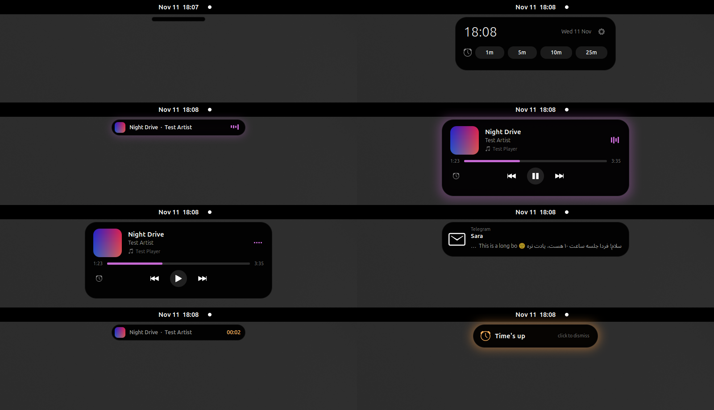
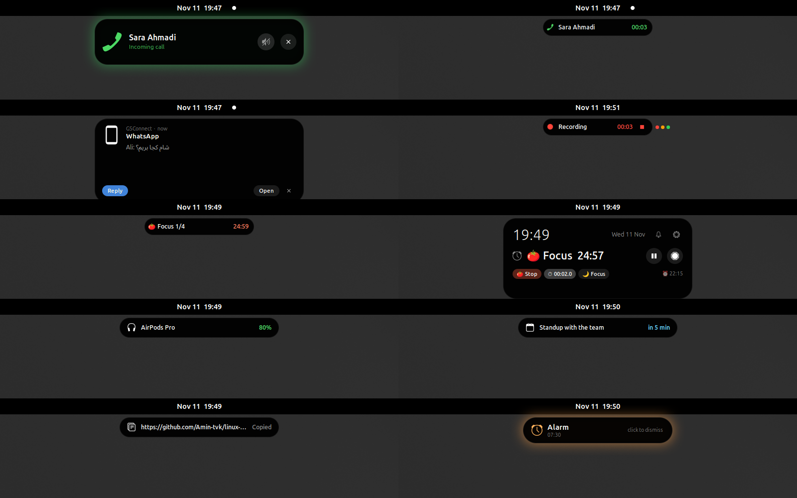
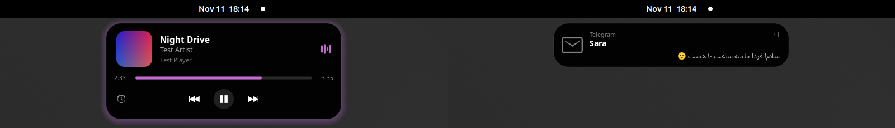

# Linux Island

**A Dynamic Island for Linux.** A black pill at the top of the screen that shows what's playing (with a visualizer that dances to the music), pops out your notifications so you can reply right there, shows volume, brightness and battery changes, and runs a timer – then shrinks back out of the way.



## Features

**Music**
- **Now playing from any app** – browsers (YouTube, SoundCloud…), Spotify, VLC, Rhythmbox, mpv… anything that speaks MPRIS. Cover art, title, artist, progress bar with click-to-seek, play / pause / next / previous.
- **Music visualizer** (on/off in Settings) – a minimal effect that follows the sound actually playing: a thin outline that pulses with the beat, or a slim spectrum under the pill. The equalizer inside the pill follows the music too.
- **Up next & playlists** – for players that publish them (VLC, Strawberry, Clementine, Rhythmbox, Lollypop, Elisa…): see the queue and your playlists and jump to any of them.
- **Colours follow the cover art**, and the island **peeks** at each new song for a moment.
- Scroll sideways to skip tracks, click the player name to switch between players, click the cover to open the player.

**Notifications**
- Telegram, WhatsApp, Discord, Bale, mail… show up **inside the island**, and GNOME's own banner no longer covers it. Banners are stopped before other notification extensions (like *notification-configurator*) see them.
- Hover a notification to expand it: full text, the app's buttons (*Mark as read*…), **Open**, and **Reply**.
- **Quick reply** for messengers: type in the island, press Enter – it opens the chat, pastes your text and sends it. If the chat window doesn't come up, nothing is typed anywhere; your text stays on the clipboard.
- **Notification list** – the bell (or right-click the island, or Super+Alt+N) shows recent notifications; a red dot means unread.

**Phone** (Android, over Bluetooth and/or [GSConnect](#phone-calls-and-sms))
- **Bluetooth calls**: with the phone connected over Bluetooth, incoming calls show the number with **Answer** and **Decline** buttons; answer and you talk through the laptop. During the call the pill shows a timer and a hang-up button.
- **Incoming calls** get their own view with the caller's name and photo, a green glow and a **Mute** button. An answered call becomes a small live timer.
- **SMS and phone notifications** (WhatsApp, Telegram… on the phone) show up like any message, and **Reply** sends your answer **through the phone**.
- **Phone status** in the clock view: battery level (over GSConnect or plain Bluetooth), charging and mobile signal; the island tells you when the phone starts charging or its battery gets low.



**System**
- **Bluetooth headphones** connecting, with their battery level.
- **Privacy dots** next to the island while the microphone (orange), camera (green) or a screen recording (red) is in use. A screen recording shows a live timer with a stop button.
- **Meeting reminders** from GNOME Calendar / your online accounts a few minutes before an event, and the next event in the clock view.
- **Clipboard peek**: a quick look at what you just copied (copies from password managers are never shown).
- **Weather** in the clock view (from GNOME Weather's location).
- **Focus mode**: one click turns Do Not Disturb on or off.
- **Volume, brightness and keyboard-layout changes** appear in the island instead of GNOME's big OSD.
- **Charger plugged / unplugged, fully charged, low battery** (20 / 10 / 5 %).
- Scroll up / down on the island to change the volume.
**Time**
- **Timer** with presets (1 / 5 / 10 / 25 min by default), pause, stop, a sound and an orange glow when time is up. Click the idle pill for the clock and timer.
- **Pomodoro**: 25 min focus / 5 min break, a long break every 4 rounds (all adjustable), with the round and time left in the pill.
- **Stopwatch** that keeps running in the pill.
- **Daily alarms** (set them in Settings), shown in the clock view; they ring and glow until you click.
- **Up to the minute**: everything that runs (recording, call, Pomodoro, timer, stopwatch) shows as a compact live activity, also next to the music.

**Yours to tune**
- **Size** (0.7× – 1.6×), **animation speed**, gap below the top bar, which **monitor**, visualizer style, and every feature on or off.
- Stays out of your way: only the pill takes clicks, it hides in full-screen apps, and it can hide completely when idle.
- Right-to-left text (Persian, Arabic, Hebrew) renders correctly. Nothing leaves your computer; notification text is never saved.

## Two versions

| | Desktop | How it works |
|---|---|---|
| **GNOME extension** (`gnome-extension/`) | GNOME 46–50: Ubuntu, Fedora, Debian, Arch, Manjaro, openSUSE, Pop!_OS… (tested on GNOME 50) | Runs inside GNOME Shell, under the top bar. Has every feature above. |
| **Standalone app** (`standalone/`) | KDE Plasma, Hyprland, Sway, Wayfire, river, XFCE, Cinnamon, MATE, Budgie… | Python + GTK 3. Wayland: layer-shell surface. X11: always-on-top dock window. Now playing, notifications, timer, clock, size and speed. |



## Install

### Any distro

```bash
git clone https://github.com/Amin-tvk/linux-island.git
cd linux-island
./install.sh
```

The installer picks the right version for your desktop. To choose yourself:

```bash
./install.sh gnome        # GNOME Shell extension
./install.sh standalone   # everything else
```

### Arch Linux, Manjaro, EndeavourOS, CachyOS, Garuda…

Build and install the package with `makepkg` (it contains both versions):

```bash
git clone https://github.com/Amin-tvk/linux-island.git
cd linux-island/packaging/arch
makepkg -si
```

Optional extras (pacman asks about them as optional dependencies):

```bash
sudo pacman -S --needed gtk-layer-shell gst-plugins-good gst-plugin-pipewire libcanberra
```

- `gtk-layer-shell` – the standalone app on KDE / Hyprland / Sway (Wayland)
- `gst-plugins-good` + `gst-plugin-pipewire` – the music visualizer (GNOME)
- `libcanberra` – the timer sound in the standalone app

Then:

- **GNOME:** log out and back in, then `gnome-extensions enable linux-island@miverasan.com`
- **Phone calls and SMS:** see [Phone calls and SMS](#phone-calls-and-sms)
- **Other desktops:** it starts at your next login, or run `linux-island` now.

To update, run `makepkg -si` again in the same folder (it pulls the latest version). To remove: `sudo pacman -R linux-island-git`.

`./install.sh` also works on Arch: it installs the dependencies with pacman and copies the files into your home folder instead of building a package.

### After installing on GNOME

**Log out and back in once** (GNOME on Wayland only loads new extensions at login). Then:

- **Super + Alt + H** – expand / collapse the island
- **Super + Alt + N** – notification list
- Settings: the gear in the clock view, the Extensions app, or `gnome-extensions prefs linux-island@miverasan.com`

### Other desktops

The installer adds the required packages with your package manager (apt, dnf, pacman, zypper, xbps or apk), installs `~/.local/bin/linux-island`, starts it and adds it to autostart. Use `--no-deps` to skip the package step.

| Distro | Packages |
|---|---|
| Debian / Ubuntu / Mint / Pop | `python3-gi python3-gi-cairo python3-cairo gir1.2-gtk-3.0 gir1.2-gtklayershell-0.1` |
| Fedora | `python3-gobject python3-cairo gtk3 gtk-layer-shell` |
| Arch / Manjaro / EndeavourOS | `python-gobject python-cairo gtk3 gtk-layer-shell` |
| openSUSE | `python3-gobject python3-gobject-cairo python3-cairo typelib-1_0-Gtk-3_0 typelib-1_0-GtkLayerShell-0_1` |

Bind `linux-island --toggle` to a key in your keyboard settings:

```
# Hyprland
bind = SUPER ALT, H, exec, linux-island --toggle
# Sway / i3
bindsym Mod4+Mod1+h exec linux-island --toggle
```

Settings live in `~/.config/linux-island/config.json` (restart the app after editing):

```json
{
  "show_media": true,
  "show_notifications": true,
  "hide_when_idle": false,
  "expand_on_hover": true,
  "top_margin": 6,
  "notification_duration": 5,
  "timer_presets": [1, 5, 10, 25],
  "ignore_apps": [],
  "monitor": null,
  "scale": 1.0,
  "animation_speed": 1.0
}
```

The standalone app reads notifications with a read-only D-Bus monitor, so your notification daemon (Plasma, dunst, mako, swaync, xfce4-notifyd…) keeps showing its own popups too. To have them only in the island, turn popups off in that daemon. Clicking a notification in the standalone app dismisses it; it can't open the sending app.

## Phone calls and SMS

Linux Island shows your Android phone's calls and messages through **GSConnect**, the GNOME version of KDE Connect. Phone and computer must be on the same Wi-Fi.

1. Install GSConnect on the computer:
   - Ubuntu / Debian: `sudo apt install gnome-shell-extension-gsconnect`
   - Fedora: `sudo dnf install gnome-shell-extension-gsconnect`
   - Arch: `sudo pacman -S gnome-shell-extension-gsconnect`
   - or from [extensions.gnome.org](https://extensions.gnome.org/extension/1319/gsconnect/)
2. Log out and back in, then enable it: `gnome-extensions enable gsconnect@andyholmes.github.io`
3. Install **KDE Connect** on the phone (Google Play or F-Droid), open it and pair with your computer (the computer shows a pairing request).
4. In KDE Connect on the phone, give it the permissions for **Telephony**, **SMS** and **Notifications** (Android asks for each). Without the *Phone* permission, calls and the signal level don't come through.

If the phone doesn't find the computer (common on a phone hotspot), add it by IP in KDE Connect: ⋮ → *Add devices by IP* → the computer's address (`ip -4 addr`).

That's it: calls ring in the island, and messages from the phone can be answered from it. If GSConnect isn't installed, the island just doesn't show phone events.

### Calls over Bluetooth (no Wi-Fi needed)

Pair the phone in GNOME Settings → Bluetooth, then on the phone open Bluetooth → the gear next to your computer and turn on **Phone calls**. PipeWire then exposes the phone's calls (`org.pipewire.Telephony`), and the island can answer and hang up. *Media audio* is optional: it only plays the phone's sound through the laptop. Text messages over Bluetooth (MAP) depend on the phone; many Android phones refuse it, so messages come through GSConnect.

## How quick reply works (GNOME)

GNOME passes notification events to apps through a separate helper process, and that helper drops the standard "reply" signal. So Linux Island replies the way you would: it opens the chat through the notification, **waits until that app's window has focus**, pastes your text and presses Enter, then puts your old clipboard back. If the app's window doesn't come up within 3 seconds, it stops and leaves the text on the clipboard. The Reply button appears for the messengers listed in Settings → *Messenger apps* (Telegram and its forks, WhatsApp clients, Signal, Discord, Slack, Element, Bale, Rubika, Eitaa, Soroush…); add your own there.

## Uninstall

```bash
./uninstall.sh
```

(or `sudo pacman -R linux-island-git` if you used the Arch package)

## Troubleshooting

- **GNOME: nothing appears** – log out and in, then check `gnome-extensions info linux-island@miverasan.com` and `journalctl --user -b | grep -i island`.
- **No visualizer** – install the GStreamer *good* plugins (`gst-plugins-good`, on Debian/Ubuntu `gstreamer1.0-plugins-good` and `gstreamer1.0-pulseaudio`). It listens to what your speakers play, so GNOME may show the microphone/recording indicator while music plays; turn *Music visualizer* off in Settings if you don't want that.
- **A player isn't shown** – check it supports MPRIS: `busctl --user list | grep mpris`.
- **No queue button** – the player doesn't publish its queue over MPRIS (Spotify and browsers don't).
- **No phone events** – check GSConnect is enabled and the phone shows as connected in its menu, and that KDE Connect on the phone has the Telephony / SMS / Notifications permissions.
- **No weather** – set a location in the GNOME Weather app. **No meeting reminders** – add your calendar in GNOME Settings → Online Accounts (or GNOME Calendar).
- **Standalone on Wayland is a normal window** – `gtk-layer-shell` isn't installed, or your compositor doesn't support layer-shell (GNOME). Run `linux-island` from a terminal to see messages.

## Development

GNOME: plain GJS (ES modules). Test without touching your session in a nested shell:

```bash
dbus-run-session -- gnome-shell --devkit   # GNOME 49+, needs mutter-dev-bin
```

Standalone: `python3 standalone/linux_island.py`.

Inspired by [HALO](https://github.com/ecch1369/halo) for Windows. Linux Island is an independent implementation; no code is shared.

## License

MIT – see [LICENSE](LICENSE).

---

<div dir="rtl">

## فارسی

**Linux Island** یک «دایناميک آیلند» برای لینوکس است: یک قرص مشکی بالای صفحه که آهنگ در حال پخش را نشان می‌دهد، نوتیفیکیشن‌ها را نمایش می‌دهد و می‌شود همان‌جا به پیام‌های تلگرام و بقیه‌ی پیام‌رسان‌ها جواب داد. **تماس و پیامک گوشی** (با GSConnect)، هدفون بلوتوث، نقطه‌های میکروفون/دوربین/ضبط صفحه، یادآور جلسه، پومودورو، کرنومتر، آلارم، آب‌وهوا، حالت مزاحم نشو، پلی‌لیست، تغییر صدا و روشنایی و شارژ باتری هم دارد. سایز و سرعت انیمیشن قابل تنظیم است.

**وصل کردن گوشی:** روی کامپیوتر <code>sudo apt install gnome-shell-extension-gsconnect</code> را نصب کنید، روی گوشی اپ **KDE Connect** را نصب و جفت کنید (هر دو روی یک وای‌فای). از این به بعد تماس‌ها و پیامک‌ها در آیلند نشان داده می‌شوند.

- **گنوم** (اوبونتو، فدورا، آرچ، منجارو…): اکستنشن گنوم
- **KDE، Hyprland، Sway، XFCE، Cinnamon** و بقیه: برنامه‌ی مستقل

**نصب روی هر توزیعی:** دستورهای بخش «Any distro» را اجرا کنید.

**نصب روی آرچ و توزیع‌های بر پایه‌ی آرچ (منجارو، اندیور، کچی):**

<div dir="ltr">

```bash
git clone https://github.com/Amin-tvk/linux-island.git
cd linux-island/packaging/arch
makepkg -si
```

</div>

در گنوم بعد از نصب یک بار log out و دوباره login کنید. میانبرها: <code>Super+Alt+H</code> برای باز و بسته کردن و <code>Super+Alt+N</code> برای لیست نوتیفیکیشن‌ها.

</div>
